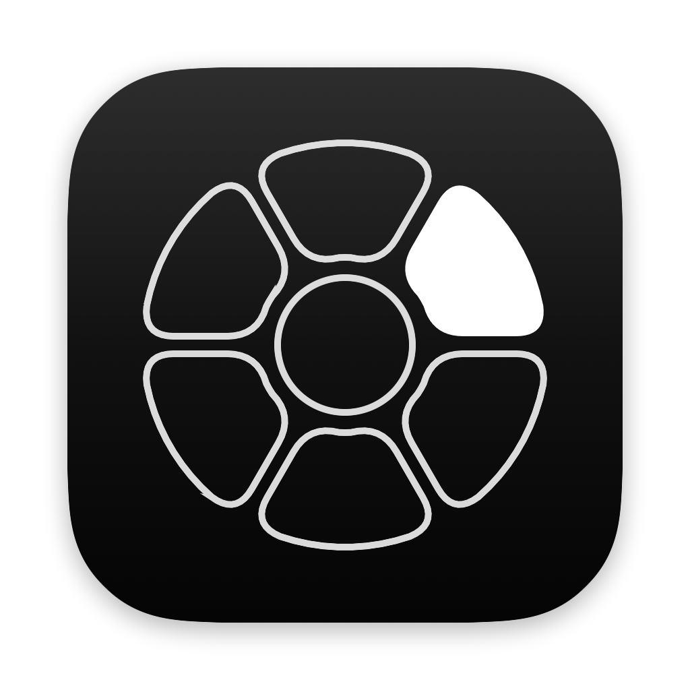
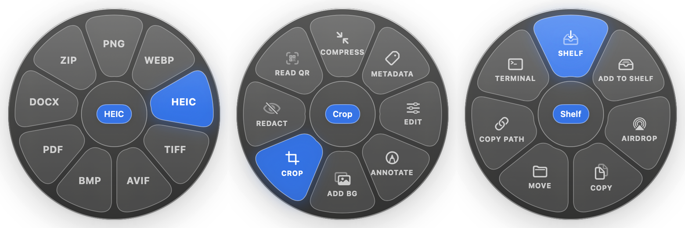
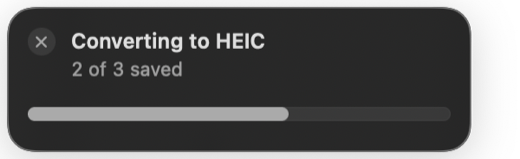
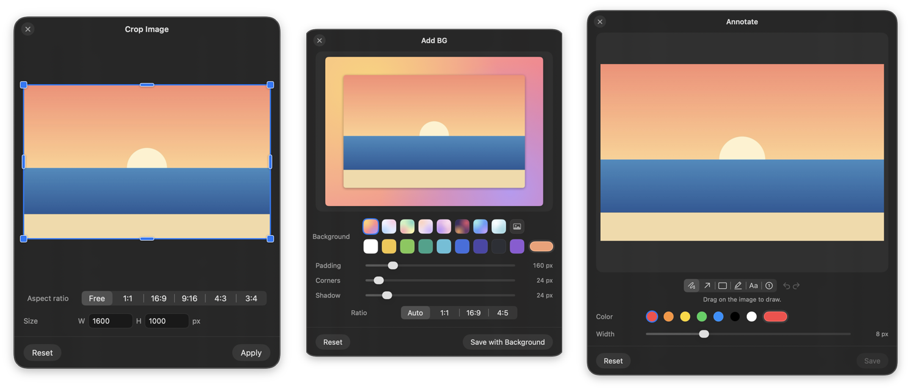
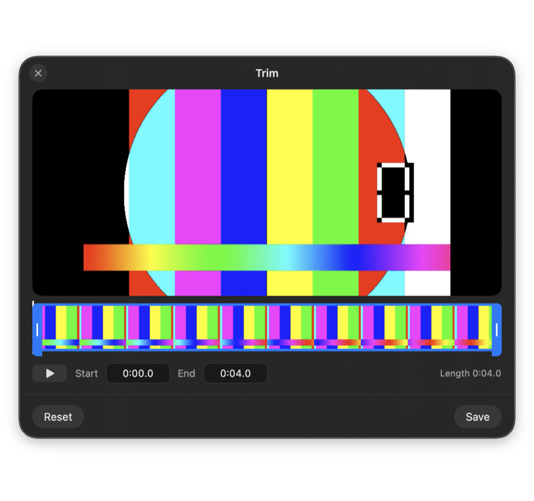
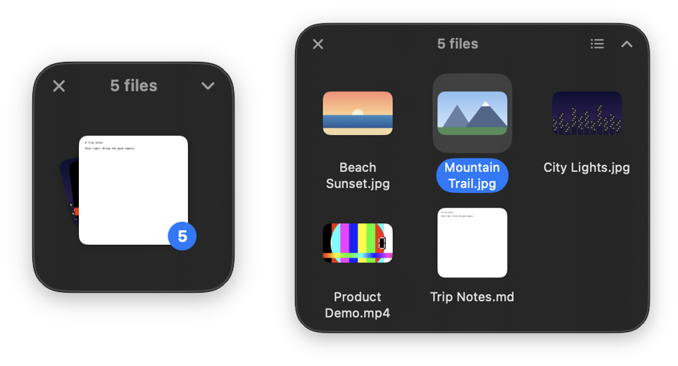

<p align="center"></p>

# OpenShelf

An open-source macOS menu-bar utility for working with files mid-drag.

Start dragging any file and tap a key — a wheel appears under the pointer. Drop
the file on a wedge and it's done, saved right next to the original.

<p align="center"></p>

- **⇧ Convert wheel:** images, PDFs, documents, spreadsheets, slides, audio,
  video, subtitles and archives into the formats that make sense for them (JPG,
  PNG, HEIC, AVIF, WEBP, PDF, DOCX, Markdown, EPUB, PPTX, XLSX, CSV, MP3, OGG,
  MKV, WebM, GIF, ZIP, TAR.GZ, …)
- **⇧⌥ Tools wheel:** for images — Crop, Resize, Remove Background, Add
  Background, Annotate, Redact, Edit, Compress, Metadata, Read QR; for PDFs —
  Combine, Pages, Split, Compress, Metadata; for video and audio — Trim,
  Speed, Crop, Rotate, Split, Merge, Compress, Mute
- **⌃ Actions wheel:** Shelf · Add to Shelf · AirDrop · Copy · Move · Copy Path · Terminal
- **Shelves:** stacked preview, expandable grid/list, multi-select, drag out to
  any app, Quick Look (Space), dock to the left/right screen edge, multiple shelves
- Works system-wide with **no Accessibility permission**
- No telemetry; the only network access is checking GitHub for updates, which
  you can turn off
- **Updates itself:** new versions install from the app (Sparkle), signed so
  only genuine OpenShelf releases are accepted

See [docs/SPEC.md](docs/SPEC.md) for the full behaviour and roadmap. Optional:
`brew install ffmpeg webp` adds MP3, GIF and WebP output.

## Install

1. Download **`OpenShelf-<version>.dmg`** from the
   [latest release](https://github.com/Manan-Santoki/OpenShelf/releases/latest).
2. Open it and drag **OpenShelf** onto the **Applications** folder.
3. Open OpenShelf from Applications. It lives in the menu bar (the wheel icon),
   and a short welcome guide appears the first time.

**"Apple could not verify OpenShelf…"** The app isn't notarized by Apple yet,
so macOS asks once on first launch:

- **macOS 15 Sequoia and later:** click **Done**, open **System Settings →
  Privacy & Security**, scroll down to the message about OpenShelf and click
  **Open Anyway**, then confirm.
- **macOS 14 Sonoma:** right-click OpenShelf in Applications → **Open** → **Open**.
- Or, in Terminal: `xattr -dr com.apple.quarantine /Applications/OpenShelf.app`

Requires macOS 14 Sonoma or later, on Apple silicon or Intel. A `.zip` of the
app is also attached to each release.

## How to use

Everything starts with a drag. Press on a file in Finder, on the Desktop, or in
any app that lets you drag files, and **keep holding** while you tap a key.

1. Start dragging one or more files.
2. While still dragging, tap a key. You don't need to keep holding it:
   - **⇧ Shift** opens the **Convert** wheel
   - **⇧⌥ Shift-Option** opens the **Tools** wheel (or add ⌥ after ⇧ to switch)
   - **⌃ Control** opens the **Actions** wheel
3. Move onto a wedge. It lights up and the label above the wheel shows what will
   happen; before you hover, it shows the file's size.
4. Let go on the wedge. Releasing anywhere else, or pressing **Esc**, cancels.
   Or, while still dragging, let go of the key and use the arrow keys and
   Return. (⌃ or ⌘ plus an arrow is a macOS shortcut, ⌃→ switches desktops,
   so the arrows wait until those keys are up.)

**Without dragging:** select files in Finder and press **⌃⌥Space**. The Convert
wheel opens at the pointer; use the arrow keys and **Return** (or click a
wedge), **Tab** to switch to Tools and Actions, **Esc** to close. The first
time, macOS asks whether OpenShelf may control Finder; that's only used to read
which files are selected. Change or turn off the shortcut in Settings →
Keyboard.

Tip: on a trackpad, press the key *after* the drag has started. Holding ⌃
before you click turns the click into a right-click.

### Convert (⇧)

The wheel only offers formats that make sense for what you're dragging, and
never the format it's already in. The result is saved **next to the original**
and nothing is ever overwritten (`Photo.jpg` → `Photo.png`, `Photo 2.png`, …).
A small card next to the pointer shows progress; click its **×** to cancel.

<p align="center"></p>

| Drag a… | Convert to |
|---|---|
| Image (JPG, PNG, HEIC, SVG, …) | PNG, JPG, WEBP, HEIC, TIFF, AVIF, BMP, PDF, DOCX, ZIP |
| PDF | DOCX, JPG, PNG, TXT, Markdown, EPUB, PPTX, XLSX, ZIP |
| Document (TXT, RTF, RTFD, DOCX, DOC, ODT, HTML, Markdown) | PDF, DOCX, TXT, Markdown, EPUB, HTML, RTF, ZIP |
| Spreadsheet (CSV, TSV, XLSX) | XLSX, CSV, TSV, PDF, ODS¹, ZIP |
| Spreadsheet (XLS, ODS)¹ | XLSX, CSV, PDF, ODS, ZIP |
| Slides (PPTX, PPT, ODP)¹ | PDF, JPG, PNG (one image per slide), ZIP |
| Audio (MP3, M4A, WAV, AIFF, FLAC, OGG², Opus², WMA², …) | MP3², M4A, WAV, AIFF, FLAC, OGG², Opus², WMA², ZIP |
| Video (MP4, MOV, MKV², WebM², AVI², WMV², …) | MP4, MOV, M4A, GIF², MP3², MKV², WebM², AVI², WMV², ZIP |
| Subtitles (SRT, VTT) | TXT, SRT, VTT, ZIP |
| Archive (ZIP, TAR, GZ, 7Z, RAR) | Unzip into a folder |
| Folder or anything else | ZIP, TAR, TAR.GZ |

Drag several files at once to convert them all; mixed selections show only the
formats every file supports. Several files sent to ZIP, TAR or TAR.GZ go into
one archive.

¹ Needs LibreOffice: `brew install --cask libreoffice`. Without it, those wedges
are hidden. Keynote files can't be converted.
² Needs ffmpeg: `brew install ffmpeg` (`brew install webp` also adds WebP).
Formats macOS can't play itself (OGG, Opus, WMA, MKV, WebM, AVI, WMV) are only
offered when ffmpeg is installed. Apple's Pages format isn't offered.

### Tools (⇧⌥)

| Drag a… | Tools |
|---|---|
| Image | **Compress** · **Metadata** · **Edit** · **Annotate** · **Add BG** · **Crop** · **Resize** · **Remove BG** · **Redact** · **Read QR** |
| Several images or PDFs | **Combine** into one PDF |
| PDF | **Pages** (reorder, rotate, delete) · **Split** · **Compress** · **Metadata** |
| Video | **Trim** · **Speed** · **Crop** · **Rotate** · **Split** · **Compress** · **Mute** |
| Audio | **Trim** · **Speed** · **Split** |
| Several videos, or several audio files | **Merge** into one file |

Most tools open a small editor. Make your changes and press the button at the
bottom right (or Return); a copy is saved next to the original with a suffix,
like `Photo Cropped.jpg`, so you can drag the result straight back into another
wheel. **Read QR**, **Combine** and **Mute** run immediately without an editor.

<p align="center"></p>
<p align="center"></p>

### Actions (⌃)

| Wedge | What it does |
|---|---|
| **Shelf** | Puts the files on a new floating shelf next to the pointer |
| **Add to Shelf** | Adds them to the shelf you used last (shown when a shelf is open) |
| **AirDrop** | Opens AirDrop with the files |
| **Copy** | Copies the files; paste in Finder to duplicate them |
| **Move** | Asks for a folder and moves the files there |
| **Copy Path** | Copies the full path of each file |
| **Terminal** | Opens Terminal in the file's folder |

### Shelves

A shelf holds files for later without moving them. Drop more files onto it at
any time, and drag them out to any app or folder when you need them.

<p align="center"></p>

- **Collapsed**, it shows a stack with a count. Drag the stack to drag every file.
- **Expand** (chevron or double-click) for a grid or list. Click, ⌘-click and
  ⇧-click to select, or drag across empty space to select several at once;
  drag a selection out together. Type the start of a name to jump to a file.
- **Space** previews with Quick Look, **⌫** removes from the shelf, **Return**
  opens, **⌘A** selects all, **Esc** collapses, **⌘W** closes. Right-click for
  more, including Share.
- Drag a shelf near the left or right edge of the screen to dock it there.
  When you move the pointer away, a docked shelf slides behind the edge and
  leaves a slim tab with the file count; hover the tab, or drag files onto it,
  to bring the shelf back.
- Shelves are still there after you quit and reopen OpenShelf, even if you
  moved or renamed the files in the meantime.
- Closing a shelf never touches your files. **New Shelf** and **Close All
  Shelves** are in the menu-bar menu.

### Updates

OpenShelf checks GitHub for new versions once a day (it asks the first time).
When one is out you'll see its release notes and an **Install Update** button;
the app restarts on the new version. Closing the window means "later"; it will
remind you again. You can also choose **Check for Updates…**
from the menu bar, or turn automatic checks and installs on or off in Settings.

### Settings

Click the OpenShelf wheel in the menu bar → **Settings…** to change the key for
each wheel, remove files from a shelf after dragging them out, restore shelves
at launch, hide docked shelves at the screen edge, control updates, or open
OpenShelf at login. **How to Use OpenShelf** in the same menu shows the welcome
guide again.

## Tech stack

| Layer | Choice |
|---|---|
| Language | Swift 6 (strict concurrency) |
| UI | SwiftUI for views; AppKit for panels, drag sessions, menu bar, Quick Look |
| Frameworks | ImageIO, Core Image, PDFKit, AVFoundation, QuickLookThumbnailing, Quartz, ServiceManagement, Observation |
| Updates | [Sparkle](https://sparkle-project.org) 2 (MIT), downloaded and checksum-verified at build time |
| Build | `make` (calls `swiftc` directly) · `Package.swift` for SwiftPM/Xcode |
| Tests | Swift Testing |
| Minimum OS | macOS 14 Sonoma |
| License | MIT |

## Build & run

Requires Xcode or the Xcode Command Line Tools.

```sh
make run      # build, bundle into build/OpenShelf.app, and launch
make app      # just build the .app
make test     # run the test suite (needs a working SwiftPM)
make release  # universal build, zipped for a GitHub release
make dmg      # drag-to-Applications installer (after make release; needs create-dmg)
```

You can also open `Package.swift` in Xcode.

## Project layout

```
Sources/OpenShelf/
  App/            entry point, app delegate, preferences
  DragDetection/  system-wide drag + modifier detection
  Wheel/          wheel items, geometry, overlay panel, SwiftUI rendering
  Convert/        format catalog, converters, progress runner
  Tools/          tool list, launcher, editor window host
  Tools/Editors/  image editors (crop, add background, annotate, …)
  Tools/PDF/      PDF tools (combine, pages, split, compress, metadata)
  Tools/Media/    video and audio tools (trim, speed, crop, rotate, split, merge, compress, mute)
  Shelf/          shelf model, floating panel, docking, layout
  Shelf/Views/    SwiftUI shelf UI and the AppKit drag source
  Support/        file actions, Quick Look
  Settings/       settings window
```

## How drag detection works

macOS doesn't announce drags from other apps, and OpenShelf asks for no special
permission. Instead, a mouse-down anywhere (mouse events can be observed without
permission) wakes it, and while the button stays down it reads three pieces of
global state every frame: the primary mouse button, the held modifier keys, and
the change count of the system drag pasteboard. When the button is down and the
drag pasteboard has changed and holds file URLs, a file drag is in progress. A
quick tap of a wheel's keys opens that wheel as soon as they're released; keys
held down count once they've been steady for ~70 ms, so pressing ⇧ on the way to
⇧⌥ doesn't flash the wrong wheel. Once the button is up, OpenShelf goes idle
again. The wheel itself is an ordinary drop target.

## Releasing

Releases are automatic and driven by [CHANGELOG.md](CHANGELOG.md):

1. Add a section for the new version at the top of `CHANGELOG.md`, e.g.
   `## [1.1.0] - 2026-11-02`, describing what changed.
2. Push to `main`.

The **Release** workflow then tests and builds the universal app on a macOS
runner, makes the DMG and zip, tags `v1.1.0` and publishes a GitHub release
with that changelog section as its notes. Versions that are already tagged are
skipped. The release also carries a signed `appcast.xml`, which is how
installed copies find the update: Sparkle reads
`releases/latest/download/appcast.xml` and only installs updates signed with
the project's EdDSA key (stored as the `SPARKLE_PRIVATE_KEY` repository
secret; the public key is `SUPublicEDKey` in `Support/Info.plist`). The **CI**
workflow builds and tests every push and pull request.

## Contributing

Issues and pull requests are welcome. Please keep OpenShelf free of third-party
assets and code you don't have the rights to — all artwork, including the app icon (`scripts/make-icon.swift`), is SF Symbols and
SwiftUI drawing.
